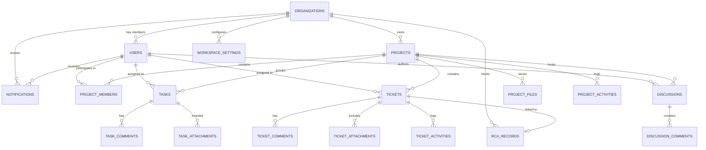

# Live Workspace — Relational Database Schema Documentation

> **Database System:** PostgreSQL 16 (Neon Hosted Serverless)  
> **Host:** `ep-muddy-cell-az6wy4dg.c-3.ap-southeast-1.aws.neon.tech`  
> **Schema Name:** `public`  
> **Total Tables:** 20 Relational Normalized Tables  
> **ORM Layer:** SQLAlchemy 2.0 (AsyncPG) & Alembic Migrations  

---

## 1. Entity-Relationship (ER) Diagram

---

## 2. Comprehensive Table Definitions

### 2.1 Core Multi-Tenancy & Identity

#### `organizations`
Represents customer enterprise tenant accounts.
| Column | Type | Constraints | Description |
| :--- | :--- | :--- | :--- |
| `id` | `VARCHAR(36)` | PRIMARY KEY | Unique tenant ID (e.g., `org_01` or UUID) |
| `name` | `VARCHAR(100)` | NOT NULL | Organization name (e.g., "Acme Tech") |
| `slug` | `VARCHAR(100)` | NOT NULL, UNIQUE | URL workspace identifier (e.g., "acme-tech") |
| `created_at` | `TIMESTAMP WITH TIME ZONE` | NOT NULL, DEFAULT now() | Creation timestamp |

#### `users`
Enterprise users belonging to organizations with roles and profile metadata.
| Column | Type | Constraints | Description |
| :--- | :--- | :--- | :--- |
| `id` | `VARCHAR(36)` | PRIMARY KEY | Unique user ID (e.g., `usr_01`) |
| `organization_id` | `VARCHAR(36)` | NOT NULL, FK(`organizations.id` ON DELETE CASCADE) | Multi-tenant tenant boundary |
| `email` | `VARCHAR(255)` | NOT NULL, UNIQUE, INDEX | User corporate email |
| `hashed_password` | `VARCHAR(255)` | NOT NULL | Bcrypt password hash |
| `full_name` | `VARCHAR(100)` | NOT NULL | Full display name |
| `role` | `VARCHAR(50)` | NOT NULL, DEFAULT 'member' | RBAC role (`owner`, `admin`, `member`, `viewer`) |
| `title` | `VARCHAR(100)` | NULL | Professional title (e.g., "SRE Lead") |
| `department` | `VARCHAR(100)` | NULL | Department (e.g., "Platform & Reliability") |
| `avatar_url` | `VARCHAR(1024)` | NULL | High-res avatar URL |
| `is_active` | `BOOLEAN` | NOT NULL, DEFAULT TRUE | Account state |
| `email_verified` | `BOOLEAN` | NOT NULL, DEFAULT FALSE | Email verification status |
| `created_at` | `TIMESTAMP WITH TIME ZONE` | NOT NULL, DEFAULT now() | Registration date |

#### `user_invitations`
Pending team member invitations.
| Column | Type | Constraints | Description |
| :--- | :--- | :--- | :--- |
| `id` | `VARCHAR(36)` | PRIMARY KEY | Invitation UUID |
| `organization_id` | `VARCHAR(36)` | NOT NULL, FK(`organizations.id` ON DELETE CASCADE) | Tenant boundary |
| `email` | `VARCHAR(255)` | NOT NULL | Invitee email |
| `role` | `VARCHAR(50)` | NOT NULL, DEFAULT 'member' | Assigned role upon joining |
| `token` | `VARCHAR(255)` | NOT NULL, UNIQUE | Claim token |
| `expires_at` | `TIMESTAMP WITH TIME ZONE` | NOT NULL | Expiration timestamp |
| `created_at` | `TIMESTAMP WITH TIME ZONE` | NOT NULL, DEFAULT now() | Dispatch timestamp |

---

### 2.2 Project Management

#### `projects`
Workspaces and repositories grouping tasks, tickets, files, and discussions.
| Column | Type | Constraints | Description |
| :--- | :--- | :--- | :--- |
| `id` | `VARCHAR(36)` | PRIMARY KEY | Project ID (e.g., `prj_01`) |
| `organization_id` | `VARCHAR(36)` | NOT NULL, FK(`organizations.id` ON DELETE CASCADE), INDEX | Tenant boundary |
| `lead_id` | `VARCHAR(36)` | NULL, FK(`users.id` ON DELETE SET NULL) | Project lead / owner |
| `name` | `VARCHAR(100)` | NOT NULL | Project name |
| `key` | `VARCHAR(20)` | NOT NULL | Project key prefix (e.g., `PLTFRM`) |
| `description` | `TEXT` | NULL | Project scope description |
| `status` | `VARCHAR(50)` | NOT NULL, DEFAULT 'active' | Status (`active`, `paused`, `completed`, `archived`) |
| `icon` | `VARCHAR(50)` | NOT NULL, DEFAULT 'rocket_launch' | Stitch icon identifier |
| `color` | `VARCHAR(50)` | NOT NULL, DEFAULT 'bg-btn-primary' | Project badge color |
| `visibility` | `VARCHAR(50)` | NOT NULL, DEFAULT 'organization' | Privacy scope |
| `sla_tier` | `VARCHAR(50)` | NOT NULL, DEFAULT 'SLA Tier 1' | Default SLA tier |
| `start_date` | `TIMESTAMP WITH TIME ZONE` | NULL | Scheduled start |
| `target_date` | `TIMESTAMP WITH TIME ZONE` | NULL | Scheduled delivery |
| `created_at` | `TIMESTAMP WITH TIME ZONE` | NOT NULL, DEFAULT now() | Creation timestamp |

#### `project_members`
Association table connecting users to projects with custom permissions.
| Column | Type | Constraints | Description |
| :--- | :--- | :--- | :--- |
| `id` | `VARCHAR(36)` | PRIMARY KEY | Membership UUID |
| `project_id` | `VARCHAR(36)` | NOT NULL, FK(`projects.id` ON DELETE CASCADE), INDEX | Project reference |
| `user_id` | `VARCHAR(36)` | NOT NULL, FK(`users.id` ON DELETE CASCADE), INDEX | User reference |
| `role` | `VARCHAR(50)` | NOT NULL, DEFAULT 'developer' | Role within project |
| `access_scope` | `VARCHAR(100)` | NOT NULL, DEFAULT 'Full Repository Write Access' | Access scope label |
| `joined_at` | `TIMESTAMP WITH TIME ZONE` | NOT NULL, DEFAULT now() | Join date |

#### `project_invitations`
External collaborator invitations for specific projects.
| Column | Type | Constraints | Description |
| :--- | :--- | :--- | :--- |
| `id` | `VARCHAR(36)` | PRIMARY KEY | Invitation UUID |
| `project_id` | `VARCHAR(36)` | NOT NULL, FK(`projects.id` ON DELETE CASCADE) | Project reference |
| `email` | `VARCHAR(255)` | NOT NULL | Invitee email |
| `role` | `VARCHAR(50)` | NOT NULL, DEFAULT 'viewer' | Target project role |
| `created_at` | `TIMESTAMP WITH TIME ZONE` | NOT NULL, DEFAULT now() | Dispatch timestamp |

#### `project_activities`
Audit timeline events for project updates.
| Column | Type | Constraints | Description |
| :--- | :--- | :--- | :--- |
| `id` | `VARCHAR(36)` | PRIMARY KEY | Activity UUID |
| `project_id` | `VARCHAR(36)` | NOT NULL, FK(`projects.id` ON DELETE CASCADE), INDEX | Project reference |
| `user_id` | `VARCHAR(36)` | NULL, FK(`users.id` ON DELETE SET NULL) | Actor user |
| `activity_type` | `VARCHAR(50)` | NOT NULL | Event classification |
| `description` | `TEXT` | NOT NULL | Activity narrative |
| `created_at` | `TIMESTAMP WITH TIME ZONE` | NOT NULL, DEFAULT now() | Event timestamp |

#### `project_files`
Central files uploaded to projects, stored in S3.
| Column | Type | Constraints | Description |
| :--- | :--- | :--- | :--- |
| `id` | `VARCHAR(36)` | PRIMARY KEY | File UUID |
| `project_id` | `VARCHAR(36)` | NOT NULL, FK(`projects.id` ON DELETE CASCADE), INDEX | Project reference |
| `uploader_id` | `VARCHAR(36)` | NULL, FK(`users.id` ON DELETE SET NULL) | Uploader user |
| `name` | `VARCHAR(255)` | NOT NULL | Display filename |
| `storage_path` | `VARCHAR(1024)` | NOT NULL | Neon S3 object key |
| `file_size` | `INTEGER` | NOT NULL | Size in bytes |
| `mime_type` | `VARCHAR(100)` | NOT NULL | MIME content type |
| `created_at` | `TIMESTAMP WITH TIME ZONE` | NOT NULL, DEFAULT now() | Upload timestamp |

---

### 2.3 Task & Kanban Management

#### `tasks`
Work items tracked across Kanban boards.
| Column | Type | Constraints | Description |
| :--- | :--- | :--- | :--- |
| `id` | `VARCHAR(36)` | PRIMARY KEY | Task UUID / Key |
| `project_id` | `VARCHAR(36)` | NOT NULL, FK(`projects.id` ON DELETE CASCADE), INDEX | Linked project |
| `assignee_id` | `VARCHAR(36)` | NULL, FK(`users.id` ON DELETE SET NULL), INDEX | Assigned engineer |
| `title` | `VARCHAR(255)` | NOT NULL | Task summary |
| `description` | `TEXT` | NULL | Detailed specifications |
| `status` | `VARCHAR(50)` | NOT NULL, DEFAULT 'todo', INDEX | Status (`todo`, `in_progress`, `in_review`, `done`) |
| `priority` | `VARCHAR(50)` | NOT NULL, DEFAULT 'medium' | Priority (`low`, `medium`, `high`, `urgent`) |
| `story_points` | `INTEGER` | NOT NULL, DEFAULT 1 | Sprint estimation points |
| `due_date` | `TIMESTAMP WITH TIME ZONE` | NULL | Target delivery date |
| `created_at` | `TIMESTAMP WITH TIME ZONE` | NOT NULL, DEFAULT now() | Creation timestamp |
| `updated_at` | `TIMESTAMP WITH TIME ZONE` | NOT NULL, DEFAULT now() | Last update timestamp |

#### `task_comments`
Comments and discussions on individual tasks.
| Column | Type | Constraints | Description |
| :--- | :--- | :--- | :--- |
| `id` | `VARCHAR(36)` | PRIMARY KEY | Comment UUID |
| `task_id` | `VARCHAR(36)` | NOT NULL, FK(`tasks.id` ON DELETE CASCADE), INDEX | Linked task |
| `author_id` | `VARCHAR(36)` | NULL, FK(`users.id` ON DELETE SET NULL) | Comment author |
| `content` | `TEXT` | NOT NULL | Comment markdown body |
| `created_at` | `TIMESTAMP WITH TIME ZONE` | NOT NULL, DEFAULT now() | Post timestamp |

#### `task_attachments`
File attachments associated with tasks.
| Column | Type | Constraints | Description |
| :--- | :--- | :--- | :--- |
| `id` | `VARCHAR(36)` | PRIMARY KEY | Attachment UUID |
| `task_id` | `VARCHAR(36)` | NOT NULL, FK(`tasks.id` ON DELETE CASCADE), INDEX | Linked task |
| `filename` | `VARCHAR(255)` | NOT NULL | File display name |
| `storage_path` | `VARCHAR(1024)` | NOT NULL | Neon S3 storage key |
| `file_size` | `INTEGER` | NOT NULL | Size in bytes |
| `created_at` | `TIMESTAMP WITH TIME ZONE` | NOT NULL, DEFAULT now() | Upload timestamp |

---

### 2.4 Ticket & Incident Governance

#### `tickets`
Service tickets and operational incidents with dual SLA timers.
| Column | Type | Constraints | Description |
| :--- | :--- | :--- | :--- |
| `id` | `VARCHAR(36)` | PRIMARY KEY | Ticket UUID |
| `project_id` | `VARCHAR(36)` | NOT NULL, FK(`projects.id` ON DELETE CASCADE), INDEX | Linked project |
| `ticket_number` | `VARCHAR(50)` | NOT NULL, UNIQUE, INDEX | Ticket display key (e.g., `TKT-1028`) |
| `reporter_id` | `VARCHAR(36)` | NULL, FK(`users.id` ON DELETE SET NULL) | Creator user |
| `assignee_id` | `VARCHAR(36)` | NULL, FK(`users.id` ON DELETE SET NULL), INDEX | Handling engineer |
| `title` | `VARCHAR(255)` | NOT NULL | Incident title |
| `description` | `TEXT` | NULL | Full description |
| `severity` | `VARCHAR(50)` | NOT NULL, DEFAULT 'MEDIUM', INDEX | Severity (`CRITICAL`, `HIGH`, `MEDIUM`, `LOW`) |
| `status` | `VARCHAR(50)` | NOT NULL, DEFAULT 'open', INDEX | Status (`open`, `investigating`, `mitigated`, `resolved`, `closed`) |
| `first_response_at` | `TIMESTAMP WITH TIME ZONE` | NULL | First responder timestamp |
| `deadline` | `TIMESTAMP WITH TIME ZONE` | NULL | SLA resolution deadline |
| `steps_to_reproduce` | `TEXT` | NULL | Reproduction steps |
| `diagnostic_trace` | `TEXT` | NULL | Stack trace / log dump |
| `rca_trigger` | `VARCHAR(100)` | NULL | Post-mortem trigger condition |
| `rca_mitigation` | `TEXT` | NULL | Interim workaround description |
| `rca_action_items` | `TEXT` | NULL | JSON string array of preventive actions |
| `created_at` | `TIMESTAMP WITH TIME ZONE` | NOT NULL, DEFAULT now() | Incident filed timestamp |
| `updated_at` | `TIMESTAMP WITH TIME ZONE` | NOT NULL, DEFAULT now() | Last update timestamp |

#### `ticket_comments`
Threaded discussion, customer notes, and internal investigation logs.
| Column | Type | Constraints | Description |
| :--- | :--- | :--- | :--- |
| `id` | `VARCHAR(36)` | PRIMARY KEY | Comment UUID |
| `ticket_id` | `VARCHAR(36)` | NOT NULL, FK(`tickets.id` ON DELETE CASCADE), INDEX | Ticket reference |
| `author_id` | `VARCHAR(36)` | NULL, FK(`users.id` ON DELETE SET NULL) | Author reference |
| `content` | `TEXT` | NOT NULL | Comment markdown body |
| `is_internal` | `BOOLEAN` | NOT NULL, DEFAULT FALSE | Internal note vs customer-facing |
| `created_at` | `TIMESTAMP WITH TIME ZONE` | NOT NULL, DEFAULT now() | Post timestamp |

#### `ticket_attachments`
Diagnostic logs, screenshots, and payloads attached to tickets.
| Column | Type | Constraints | Description |
| :--- | :--- | :--- | :--- |
| `id` | `VARCHAR(36)` | PRIMARY KEY | Attachment UUID |
| `ticket_id` | `VARCHAR(36)` | NOT NULL, FK(`tickets.id` ON DELETE CASCADE), INDEX | Ticket reference |
| `filename` | `VARCHAR(255)` | NOT NULL | Display filename |
| `storage_path` | `VARCHAR(1024)` | NOT NULL | Neon S3 object key |
| `file_size` | `INTEGER` | NOT NULL | Size in bytes |
| `mime_type` | `VARCHAR(100)` | NOT NULL | MIME content type |
| `created_at` | `TIMESTAMP WITH TIME ZONE` | NOT NULL, DEFAULT now() | Upload timestamp |

#### `ticket_activities`
Immutable audit log of ticket lifecycle events (severity changes, reassignments, deadline extensions).
| Column | Type | Constraints | Description |
| :--- | :--- | :--- | :--- |
| `id` | `VARCHAR(36)` | PRIMARY KEY | Activity UUID |
| `ticket_id` | `VARCHAR(36)` | NOT NULL, FK(`tickets.id` ON DELETE CASCADE), INDEX | Ticket reference |
| `actor_id` | `VARCHAR(36)` | NULL, FK(`users.id` ON DELETE SET NULL) | Actor user |
| `activity_type` | `VARCHAR(50)` | NOT NULL | Event classification |
| `description` | `TEXT` | NOT NULL | Human-readable audit narrative |
| `created_at` | `TIMESTAMP WITH TIME ZONE` | NOT NULL, DEFAULT now() | Event timestamp |

---

### 2.5 Incident Post-Mortem & RCA

#### `rca_records`
Structured Root Cause Analysis reports linked to major incidents.
| Column | Type | Constraints | Description |
| :--- | :--- | :--- | :--- |
| `id` | `VARCHAR(36)` | PRIMARY KEY | RCA UUID (e.g., `rca_01`) |
| `ticket_id` | `VARCHAR(36)` | NOT NULL, FK(`tickets.id` ON DELETE CASCADE), INDEX | Linked incident ticket |
| `organization_id` | `VARCHAR(36)` | NOT NULL, FK(`organizations.id` ON DELETE CASCADE), INDEX | Tenant boundary |
| `author_id` | `VARCHAR(36)` | NULL, FK(`users.id` ON DELETE SET NULL) | Engineer author |
| `title` | `VARCHAR(255)` | NOT NULL | Post-mortem report title |
| `incident_date` | `TIMESTAMP WITH TIME ZONE` | NOT NULL | Time of incident onset |
| `severity` | `VARCHAR(50)` | NOT NULL | Incident severity |
| `five_whys` | `TEXT` | NULL | JSON array of iterative 5-whys |
| `root_cause` | `TEXT` | NOT NULL | Definitive root cause explanation |
| `immediate_mitigation` | `TEXT` | NOT NULL | Remediation steps executed |
| `preventative_actions` | `TEXT` | NULL | JSON array of action items |
| `impact_summary` | `TEXT` | NULL | Downtime & customer impact |
| `status` | `VARCHAR(50)` | NOT NULL, DEFAULT 'DRAFT' | State (`DRAFT`, `SUBMITTED`, `APPROVED`) |
| `approved_by_id` | `VARCHAR(36)` | NULL, FK(`users.id` ON DELETE SET NULL) | Approving SRE Lead / Admin |
| `approved_at` | `TIMESTAMP WITH TIME ZONE` | NULL | Sign-off timestamp |
| `created_at` | `TIMESTAMP WITH TIME ZONE` | NOT NULL, DEFAULT now() | Creation timestamp |
| `updated_at` | `TIMESTAMP WITH TIME ZONE` | NOT NULL, DEFAULT now() | Last update timestamp |

---

### 2.6 Collaboration & Team Discussions

#### `discussions`
Team discussion threads linked to projects.
| Column | Type | Constraints | Description |
| :--- | :--- | :--- | :--- |
| `id` | `VARCHAR(36)` | PRIMARY KEY | Discussion ID (e.g., `disc_01`) |
| `project_id` | `VARCHAR(36)` | NOT NULL, FK(`projects.id` ON DELETE CASCADE), INDEX | Project reference |
| `author_id` | `VARCHAR(36)` | NULL, FK(`users.id` ON DELETE SET NULL) | Thread author |
| `title` | `VARCHAR(255)` | NOT NULL | Discussion title |
| `content` | `TEXT` | NOT NULL | Markdown content |
| `category` | `VARCHAR(50)` | NOT NULL, DEFAULT 'General' | Category (Architecture, RFC, QA) |
| `is_pinned` | `BOOLEAN` | NOT NULL, DEFAULT FALSE | Pinned to top of hub |
| `is_resolved` | `BOOLEAN` | NOT NULL, DEFAULT FALSE | Thread resolution flag |
| `reactions` | `TEXT` | NULL | JSON dictionary of emoji reactions |
| `created_at` | `TIMESTAMP WITH TIME ZONE` | NOT NULL, DEFAULT now() | Thread start timestamp |
| `updated_at` | `TIMESTAMP WITH TIME ZONE` | NOT NULL, DEFAULT now() | Last update timestamp |

#### `discussion_comments`
Replies within a discussion thread.
| Column | Type | Constraints | Description |
| :--- | :--- | :--- | :--- |
| `id` | `VARCHAR(36)` | PRIMARY KEY | Reply UUID |
| `discussion_id` | `VARCHAR(36)` | NOT NULL, FK(`discussions.id` ON DELETE CASCADE), INDEX | Parent discussion |
| `author_id` | `VARCHAR(36)` | NULL, FK(`users.id` ON DELETE SET NULL) | Reply author |
| `content` | `TEXT` | NOT NULL | Reply markdown body |
| `created_at` | `TIMESTAMP WITH TIME ZONE` | NOT NULL, DEFAULT now() | Reply timestamp |

---

### 2.7 System Governance & Notifications

#### `notifications`
Application event notifications delivered to users.
| Column | Type | Constraints | Description |
| :--- | :--- | :--- | :--- |
| `id` | `VARCHAR(36)` | PRIMARY KEY | Notification UUID |
| `organization_id` | `VARCHAR(36)` | NOT NULL, FK(`organizations.id` ON DELETE CASCADE), INDEX | Tenant boundary |
| `user_id` | `VARCHAR(36)` | NOT NULL, FK(`users.id` ON DELETE CASCADE), INDEX | Recipient user |
| `actor_id` | `VARCHAR(36)` | NULL, FK(`users.id` ON DELETE SET NULL) | Triggering user |
| `type` | `VARCHAR(50)` | NOT NULL | Notification type (`task_assigned`, `ticket_assigned`, `mention`, `sla_warning`) |
| `title` | `VARCHAR(255)` | NOT NULL | Notification header |
| `body` | `TEXT` | NOT NULL | Notification message body |
| `is_read` | `BOOLEAN` | NOT NULL, DEFAULT FALSE, INDEX | Read status |
| `target_id` | `VARCHAR(50)` | NULL | Referenced entity key |
| `target_type` | `VARCHAR(50)` | NULL | Entity type (`ticket`, `task`, `project`) |
| `target_route` | `VARCHAR(255)` | NULL | Direct SPA navigation route |
| `created_at` | `TIMESTAMP WITH TIME ZONE` | NOT NULL, DEFAULT now() | Event timestamp |

#### `workspace_settings`
Configurable tenant policies for SLA tiers, notification preferences, and RBAC matrix.
| Column | Type | Constraints | Description |
| :--- | :--- | :--- | :--- |
| `id` | `VARCHAR(36)` | PRIMARY KEY | Settings UUID |
| `organization_id` | `VARCHAR(36)` | NOT NULL, UNIQUE, FK(`organizations.id` ON DELETE CASCADE), INDEX | Tenant boundary |
| `sla_config` | `TEXT` | NULL | JSON string of SLA response/resolution thresholds |
| `notification_rules`| `TEXT` | NULL | JSON string of notification delivery policies |
| `appearance` | `TEXT` | NULL | JSON string of workspace branding & theme options |
| `rbac_matrix` | `TEXT` | NULL | JSON string of role-to-permission mappings |
| `updated_at` | `TIMESTAMP WITH TIME ZONE` | NOT NULL, DEFAULT now() | Last update timestamp |
