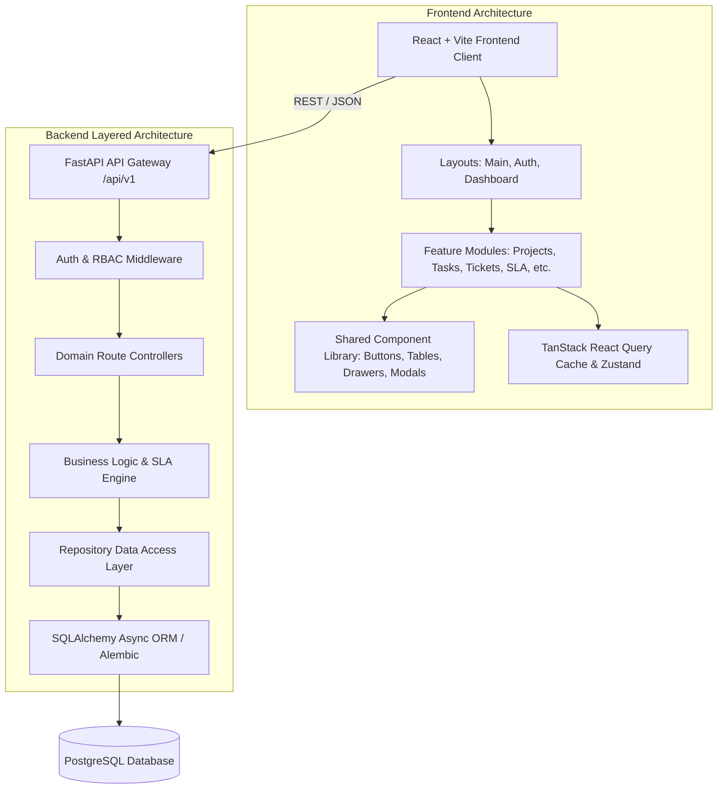

# Live Workspace — Application Architecture Specification

## 1. System Overview

Live Workspace is an enterprise SaaS platform for unified engineering collaboration, task tracking, ticketing with strict dual-SLA guarantees, root cause analysis (RCA), and organization-level workspace management.

---

## 2. Frontend Architectural Principles

1. **Feature-Based Modular Structure**:
   - Each business capability lives within `src/modules/<module-name>/`.
   - Each module contains encapsulated `components/`, `pages/`, `hooks/`, `services/`, and `utils/`, exported cleanly via `index.js`.
2. **Centralized Reusable UI Components**:
   - Generic inputs, buttons, tables, cards, dialogs, drawers, and feedback banners live strictly in `src/components/`.
   - No duplicate button or modal styling inside individual features.
3. **Decoupled API Client & Data Fetching**:
   - Network requests are isolated in `services/` and integrated with `@tanstack/react-query` to provide optimistic updates, caching, and automatic refetching.
4. **Layout-Driven Views**:
   - `AuthLayout` for unauthenticated onboarding flows.
   - `DashboardLayout` for persistent shell, collapsible sidebar, top bar search, and quick action (+) menu.
   - `MainLayout` for public landing and external documentation.

---

## 3. Backend Architectural Principles

1. **Layered Decoupled Architecture**:
   - **Routes / Controllers (`backend/app/routes/`)**: Handle HTTP request parsing, status codes, query validation, and response serialization.
   - **Services Layer (`backend/app/services/`)**: Enforce business invariants, calculate dual SLA timers, execute audit logging, and coordinate transactions.
   - **Repositories Layer (`backend/app/repositories/`)**: Encapsulate SQLAlchemy queries, joins, and database operations.
   - **Models (`backend/app/models.py`)**: Declarative SQLAlchemy ORM definitions with UUID primary keys and relationship integrity.
   - **Schemas (`backend/app/schemas.py`)**: Strict Pydantic v2 schemas (`model_config = ConfigDict(from_attributes=True)`).
2. **Asynchronous I/O**:
   - Native Python `async`/`await` powered by `asyncpg` and SQLAlchemy async session management.
3. **Defense in Depth Security**:
   - JWT token authentication (`python-jose`) with expiration and refresh mechanics.
   - Password hashing with `bcrypt`.
   - Comprehensive role-based access control (RBAC) enforced via FastAPI dependency injection.

---

## 4. Cross-Cutting Concerns

- **Dual-Timer SLA System**: Strict separation between First-Response SLA and Resolution SLA.
- **Severity vs Status**: Clear segregation between ticket severity (Blocker, Critical, Major) and workflow status (Open, WIP, On-Hold, Resolved, Closed).
- **Audit Trails**: Every state mutation produces an immutable system activity log entry with before/after diffs.
