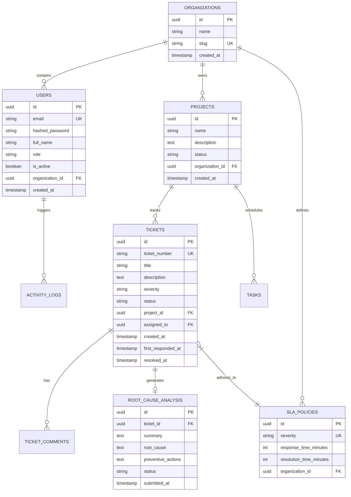

# Live Workspace — Database Architecture & Schema Specification

## 1. Engine & Database Strategy

- **Database**: PostgreSQL 16+
- **Driver**: `asyncpg` (Asynchronous driver for high throughput)
- **ORM**: SQLAlchemy 2.0 (Declarative Mapping)
- **Migrations**: Alembic

---

## 2. Entity-Relationship Model

---

## 3. Indexing Strategy

1. **Composite Indexes**:
   - `(organization_id, status)` on `tickets` and `projects` for fast filtered listing.
   - `(ticket_id, created_at DESC)` on `ticket_comments` and `activity_logs`.
2. **Unique Indexes**:
   - `organizations.slug`
   - `users.email`
   - `tickets.ticket_number`
3. **Foreign Key Performance**:
   - All foreign keys are indexed explicitly to optimize joins.
