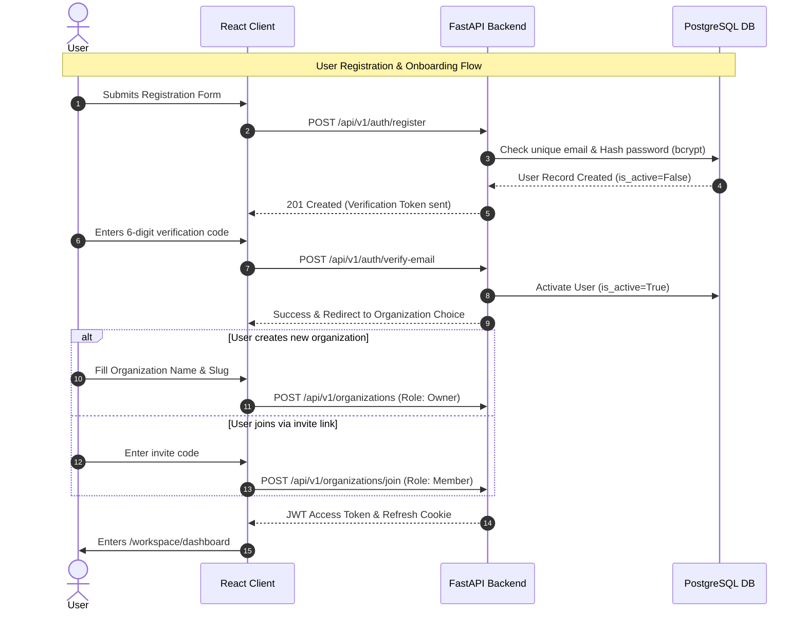

# Live Workspace — Authentication & Onboarding Workflow

## 1. Overview

The authentication lifecycle covers registration, email verification, organization creation or invitation joining, password recovery, session management via JWT, and profile completion.

---

## 2. Token Specification & Security Policies

- **Access Token**: JWT containing `sub` (User UUID), `org_id`, `role`, and expiration (`exp`: 60 minutes).
- **Refresh Strategy**: Sliding window refresh with 7-day TTL stored in an `HttpOnly`, `SameSite=Lax`, `Secure` cookie.
- **Password Requirements**: Minimum 8 characters, uppercase, lowercase, number, and special character.
