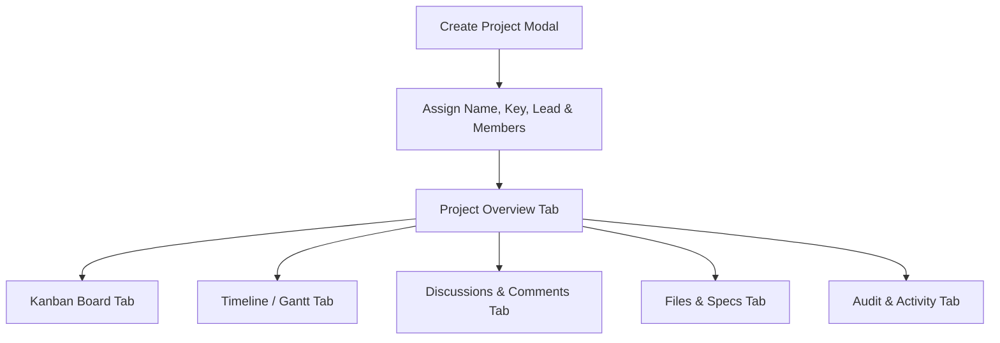

# Live Workspace — Project Management Workflow

## 1. Overview

Projects in Live Workspace serve as the central collaborative container for engineering sprints, cross-functional initiatives, bug triage batches, and documentation assets.

---

## 2. Project Lifecycle States

1. **Active**: Default state. Accepting tasks, tickets, discussions, and file uploads.
2. **On Hold**: Work temporarily paused. SLA clocks can optionally be configured to pause.
3. **Completed**: Project milestones met. Closes sprint tasks.
4. **Archived**: Read-only historical state. Retained for audit and compliance.
