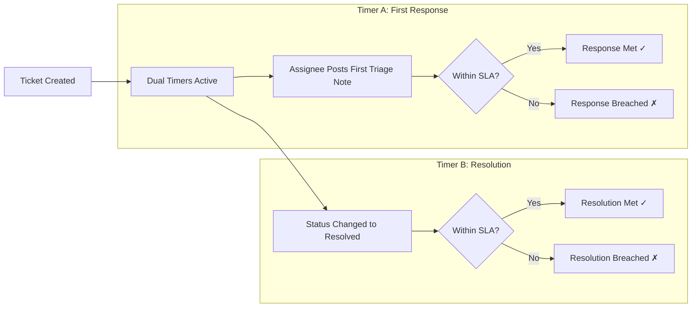

# Live Workspace — SLA Engine & Dual-Timer Workflow

## 1. The Dual-Timer Architecture

Every operational ticket runs two synchronized SLA timers:
1. **First-Response Timer**: Measures the duration from ticket creation until the first meaningful triage or assignee communication.
2. **Resolution Timer**: Measures the elapsed duration from creation until the ticket enters `Resolved` status.

---

## 2. Dynamic Visual Warning Thresholds

Timers change visual states based on remaining time:

| Timer State | Remaining Time % | Visual Indicator | Notification Trigger |
| :--- | :--- | :--- | :--- |
| **Normal** | > 25% | Charcoal / Neutral (`#5C5C70`) | None |
| **Warning** | 10% - 25% | Amber Alert (`#F8A040`) | In-app warning toast to assignee |
| **Urgent** | < 10% | Flashing Amber (`#F8C048`) | Slack / email alert to manager |
| **Breached** | 0% | Blocker Red (`#F55354`) | High-priority banner & audit incident |

---

## 3. SLA Exceptions & Pauses

- Tickets placed into `On Hold` status with verified vendor dependencies can pause the resolution timer if policy permits.
- Any manual SLA clock adjustment requires Manager approval and generates an immutable audit log entry.
