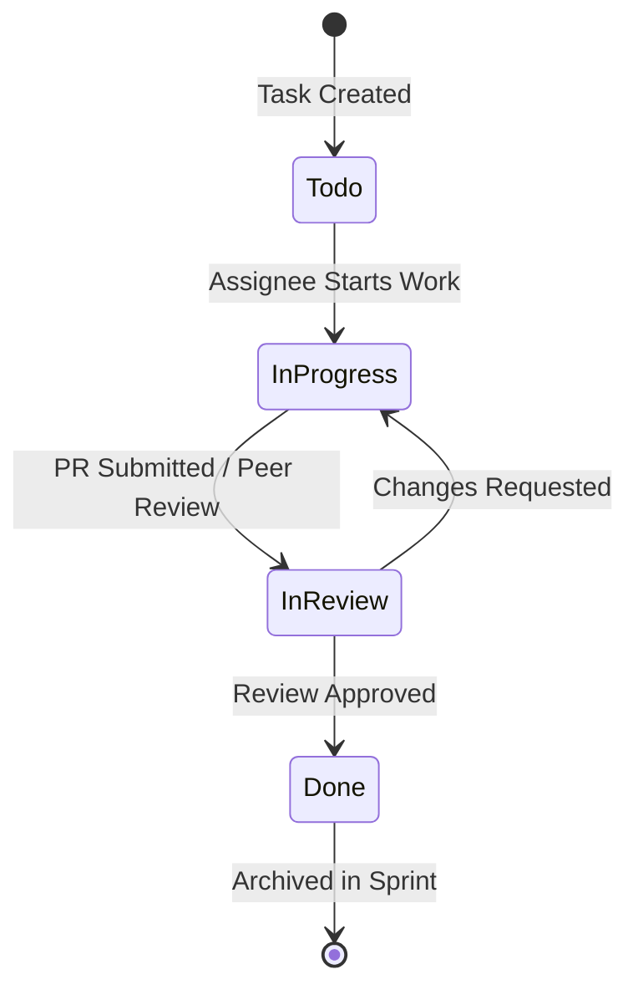

# Live Workspace — Task Execution Workflow

## 1. Overview

Tasks represent discrete engineering actions assigned to individuals or teams with explicit deadlines, priorities, checklist items, and contextual discussion threads.

---

## 2. Interaction Patterns

- **Right Drawer Quick View**: Clicking any task in the task list or Kanban board immediately expands the 560px contextual slide-over drawer without leaving the view.
- **Inline Status Popover**: Clicking the status pill triggers an inline dropdown popover for zero-latency stage transition.
- **Rich Comments & Attachments**: Integrated WYSIWYG comment composer supporting markdown, file attachments, and user `@mentions`.
