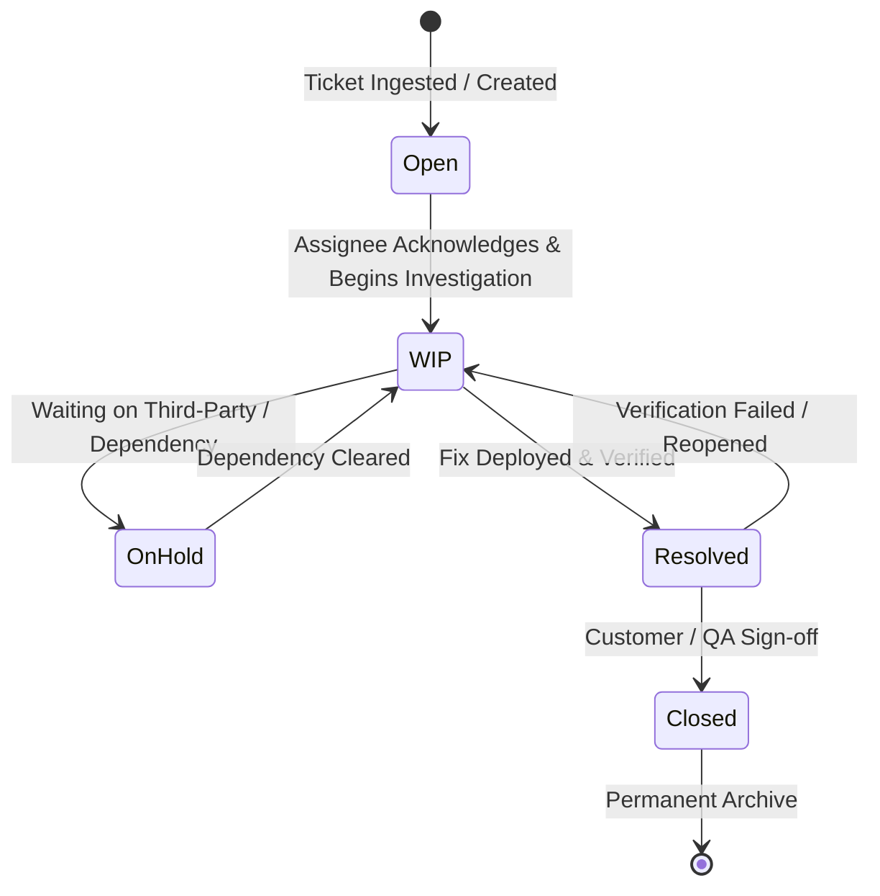

# Live Workspace — Ticket Lifecycle & Severity Workflow

## 1. Overview & Core Philosophy

Live Workspace enforces a strict conceptual separation between:
1. **Ticket Severity**: The intrinsic impact of the defect or incident (Blocker, Critical, Major).
2. **Ticket Workflow Status**: The operational phase of work (Open, WIP, On Hold, Resolved, Closed).

---

## 2. Severity Classification Matrix

| Severity | Color Code | SLA First Response | SLA Resolution | Escalation Trigger |
| :--- | :--- | :--- | :--- | :--- |
| **Blocker** | `#F55354` (Red) | 15 minutes | 2 hours | Page on-call engineering lead immediately |
| **Critical** | `#F8A040` (Orange) | 1 hour | 8 hours | Slack / Webhook alert to incident response team |
| **Major** | `#F8C048` (Yellow) | 4 hours | 24 hours | Standard dashboard triage queue |

---

## 3. Transition Rules & Modals

- **Status Transition Modals**: Moving to `On Hold` mandates entering a block reason.
- **Severity Change Modal**: Changing severity recalculates active SLA countdown timers and prompts for justification.
- **Close Modal**: Requires resolution notes and prompts for Root Cause Analysis (RCA) creation if severity was `Blocker` or `Critical`.
